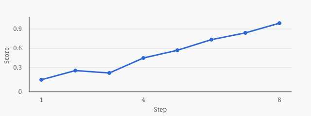
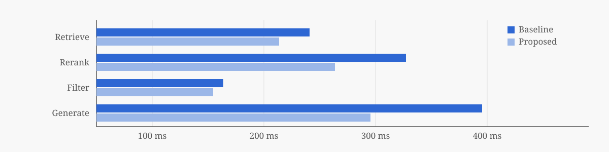
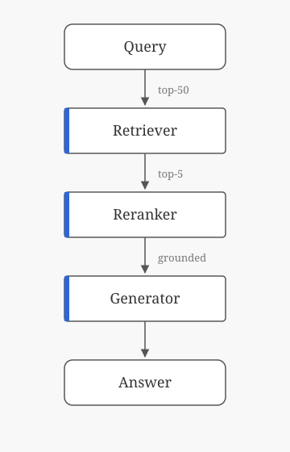

# Markdown 樣式總覽<br>Comprehensive Style Specimen

<p class="subtitle">字體 · 段落 · 行內元素 · 清單 · 引用 · 程式碼 · 表格 · 數學 · 圖片 · 分頁</p>
<p class="author">VSCodePDF themes — claude / classic / latex</p>
<p class="date">2026-10-18</p>

## 文件導讀

這份文件把 Markdown 可能出現的元素集中在一起，用來比較不同主題在 PDF 中的實際表現。每一節先說明要觀察的重點，再列出一般情境與較嚴苛的邊界案例；同一種元素會同時出現中文、英文與混排內容，方便檢查字體、字距與行距是否協調。

> **檢視重點**：版面層次是否清楚、中英文是否協調、長內容是否自然換行並完整留在版心內，以及分頁時標題、表格與程式碼是否仍保持可讀。

## 字體與段落

### 中文段落

排版的目的，是讓讀者能夠持續而專注地閱讀。當段落較長時，行距與字距共同決定了文字的灰度：行距太緊，視線容易跳行；行距太鬆，段落又會顯得零散。理想的中文段落應該讓每一行都有穩定的節奏，標點不擠壓相鄰的文字，句子之間的停頓也能自然地被看見。這一段刻意寫得比較長，用來觀察多行中文在版心內的整體密度，以及行尾是否出現過多空白。

第二個段落用來觀察段落之間的距離。段距應該能清楚分隔不同的論點，但不應大到讓文章看起來像一條一條的筆記。

### 英文段落

Good typography is invisible: it lets the reader follow an argument without noticing the page. Ligatures such as *fi*, *fl*, *ffi* and *ffl* in words like *office*, *flow*, *efficient* and *baffle* should join naturally, while kerning pairs such as AV, To, Wa and Yo keep capitals evenly spaced. Numbers like 1,234,567.89 and 3.14159 should sit on the same baseline as the surrounding text.

A second English paragraph checks the rhythm of longer passages. When the measure is generous, the eye needs enough leading to return to the start of the next line without losing its place, especially in technical writing that mixes prose with identifiers, version numbers such as v2.10.3, and timestamps like 2026-10-18 14:05:09.

### 中英文混排

學術排版常同時出現中文、English terminology、阿拉伯數字 0123456789 與單位，例如 12.5%、25 °C、1.25 ms、3.2 GB 與 4K 解析度。當句子包含 A4、PDF、Markdown、LaTeX、GPU 與 API 等縮寫時，西文的大小與基線應與中文協調。

有空格的混排：使用 Python 3.12 執行 batch size 為 64 的實驗。沒有空格的混排：使用Python 3.12執行batch size為64的實驗。兩種寫法並列，可用來比較中西文之間的間距。

### 標點與符號

中文標點：「單引號」、『雙引號』、（括號）、《書名》、〈篇名〉、【方括號】、頓號、句號。逗號，分號；冒號：問號？驚嘆號！刪節號……破折號——間隔號·。

西文標點與符號：“double quotes”, ‘single quotes’, it’s, (parentheses), [brackets], an en dash 3–50, an em dash—used sparingly, an ellipsis…, and the symbols © ® ™ § ¶ † ‡ • ‰ ° ′ ″.

數學與箭頭符號：± × ÷ ≈ ≠ ≤ ≥ ∞ √ ∑ ∫ ∂ ∇ ∈ ∉ ⊂ ∪ ∩ → ← ↑ ↓ ⇒ ⇔；分數 ½ ¼ ¾ ⅓；希臘字母 α β γ δ ε θ λ μ π σ φ ω Δ Σ Ω。

### 換行與分段

第一行以 Markdown 的兩個空格結尾，示範明確換行。  
第二行以反斜線結尾，也會在同一段落內換行。\
第三行使用 HTML 的 `<br>` 換行。<br>
第四行之後才結束這個段落，用來比較「換行」與「分段」的差別。

這是緊接在換行示例後的新段落。

### 長字串與斷行

長網址應留在版心內，且在 PDF 中保持可點擊：<https://example.org/research/typography/experiments/a4-normal-margin/long-document-layout-and-readable-table-comparison?language=zh-Hant&format=pdf>。

長識別字：`retrieval_pipeline_evaluation_configuration_with_extended_context_window`，以及不含程式碼標記的 experiment_configuration_with_a_very_long_unbroken_identifier_for_safe_wrapping。

長英文單字：pneumonoultramicroscopicsilicovolcanoconiosis 與 antidisestablishmentarianism 應能完整顯示，必要時才在字中斷開。

連續的中文長句子沒有任何標點也應該在版心邊緣自然換行而不會超出頁面或擠壓相鄰的文字這一句刻意不加標點用來檢查中文的斷行行為是否穩定

## 行內元素

### 強調與語意標記

一般文字、**粗體重點**、*斜體強調*、***粗斜體***、~~已刪除的內容~~、<u>底線文字</u>、<mark>螢光標示</mark>、<ins>插入的文字</ins>、<del>刪除的文字</del>、<s>不再正確的內容</s>，以及 <small>較小的附註文字</small>，應保有清楚但不過度突出的差異。

English emphasis: **important finding**, *working assumption*, ***critical observation***, ~~superseded result~~, <mark>highlighted phrase</mark>, and <small>fine print</small>.

其他語意標記：<abbr title="Portable Document Format">PDF</abbr> 與 <abbr title="Graphics Processing Unit">GPU</abbr> 縮寫、<cite>《排版的要素》</cite>引用出處、<q>行內引語</q>、變數 <var>n</var> 與 <var>k</var>、程式輸出 <samp>Process finished with exit code 0</samp>。

上下標：H<sub>2</sub>O、CO<sub>2</sub>、x<sup>2</sup>、10<sup>−3</sup>、e<sup>iπ</sup> + 1 = 0、第 1<sup>st</sup> 與 2<sup>nd</sup>。上下標不應把整行的行距撐大。

### 連結

行內連結：[Markdown 語法說明](https://commonmark.org/help/)；參考式連結：[CommonMark 規格][commonmark]；自動連結：<https://example.org/docs>；直接貼上的網址 https://example.org/plain-url 也會成為連結；電子郵件：<typesetting@example.org>。

連結內也可以包含其他元素：[**粗體連結**](https://example.org/bold)、[`code` 連結](https://example.org/code)。文件內部連結會跳到對應章節，例如前往[數學公式](#數學公式)。

[commonmark]: https://spec.commonmark.org/ "CommonMark Spec"

### 行內程式碼與按鍵

行內程式碼：`std::vector<double>`、`retrieval.py`、`batch_size = 64`、`a < b && c > d`、`{"key": "value"}`。粗體中的程式碼：**設定 `learning_rate` 前先確認資料量**。

鍵盤組合：<kbd>Ctrl</kbd> + <kbd>Shift</kbd> + <kbd>P</kbd>、<kbd>Alt</kbd> + <kbd>F4</kbd>、<kbd>⌘</kbd> + <kbd>K</kbd>、<kbd>Esc</kbd>。

### 符號與表情

Unicode 表情與狀態符號：✅ 已完成、⚠️ 注意、❌ 失敗、📌 標記、🚀 發布、★ 評分 ★★★☆☆。行內圖示  應與文字基線對齊。

## 標題階層

### 第三級標題：方法與觀察

標題的大小、字重與上下留白，應清楚表達文件結構。主標題與章節標題不必使用過大的字體，也應能讓讀者快速辨識閱讀順序。

#### 第四級標題：資料假設

第四級標題適合用於章節中的補充細節。

##### 第五級標題：參數說明

較低層級的標題應保持可讀性，而不與正文混淆。

###### 第六級標題：實作備註

這是最末層的標題與內文，用來觀察小字級、編號及弱化色彩的搭配。

### 這是一個相當長的第三級標題，用來檢查標題換行之後的行距、對齊與編號是否仍然清楚易讀

長標題換行後，第二行應與第一行對齊，且不應與下方段落過度貼近。

### 含有 `inline_code` 與 English 的標題

標題中的行內程式碼應與標題字級協調。

### 緊接下一層標題的標題
#### 直接接續的第四級標題

兩個標題緊接出現時，間距應比「標題與正文」之間略小，但仍能分辨層級。

## 清單

### 無序清單

- 第一項：簡短的項目內容。
- 第二項：較長的內容需要自然換行，換行後應與項目文字對齊，而不是退回項目符號的位置。
  - 第二層：補充說明與相關條件。
  - 第二層：包含 `inline_code`、**粗體重點**與[連結](https://example.org/list)。
    - 第三層：觀察符號與縮排是否容易辨識。
      - 第四層：更深的巢狀層級仍應保持清楚的縮排。
- 第三項：結束後應與後續段落保有適當距離。

### 有序清單

1. 先提出問題，說明研究的背景與限制。
2. 再描述方法，列出資料、參數與操作順序。
   1. 準備輸入資料。
   2. 執行核心步驟。
      1. 檢查中間結果。
      2. 確認輸出格式。
3. 最後回報結果與觀察。

有序清單也可以從指定的編號開始：

5. 第五步：延續上一節的流程。
6. 第六步：清單編號應從 5 開始，而不是重新從 1 算起。
7. 第七步：兩位數編號 10 以上時，項目文字仍應對齊。
8. 第八步。
9. 第九步。
10. 第十步：編號變成兩位數後，文字起點應與前面的項目一致。

### 混合巢狀清單

1. 有序清單中的無序子清單：
   - 子項目甲
   - 子項目乙
2. 無序清單中的有序子清單：
   - 準備環境：
     1. 安裝相依套件。
     2. 下載資料集。
   - 執行實驗。

### 同一項目中的多個段落

1. 這是第一個項目的第一段，用來描述主要步驟。

   這是同一個項目的第二段，兩段之間應保有可辨識的間距。項目符號不應重複出現，文字也不應被壓成一段。

   > 項目內也可以包含引用，引用縮排應與清單層級協調。

2. 這是第二個項目，內含一段程式碼：

   ```python
   for epoch in range(3):
       train(model, loader)
   ```

3. 這是第三個項目，內含一張表格：

   | 參數 | 值 |
   |:---|---:|
   | batch_size | 64 |
   | learning_rate | 2e-5 |

### 待辦清單

- [x] 檢查中英文與行內元素。
- [x] 確認多段清單的段落距離。
- [ ] 檢查不同寬度與內容密度的表格。
  - [x] 數值表。
  - [ ] 寬表與跨頁表。
- [ ] 檢查長表格、長程式碼與手動分頁。

### 定義清單

<dl>
  <dt>版心 / Text block</dt>
  <dd>扣除頁面邊界後，實際容納文字、表格與圖片的區域。</dd>
  <dt>閱讀節奏 / Reading rhythm</dt>
  <dd>字體、字距、行距與段落間距共同形成的視覺節奏。</dd>
  <dd>同一個術語也可以有第二段說明，用來檢查連續定義之間的距離。</dd>
  <dt>灰度 / Typographic color</dt>
  <dd>從遠處觀看時，文字區塊整體呈現的深淺與均勻程度。</dd>
</dl>

## 引用與補充內容

### 段落引用

> 這是一段中文引用。它應與正文保持一致的閱讀品質，透過縮排與左側線條表達層次，而不是依靠過重的背景裝飾。
>
> This quotation contains a second paragraph. The change in paragraph should remain visible, while the quotation as a whole stays connected to the surrounding discussion.

### 巢狀引用

> 第一層引用：提出問題。
>
> > 第二層引用：回應第一層的觀點。
> >
> > > 第三層引用：觀察多層縮排與線條之間的距離是否仍然清楚。

### 引用中的其他元素

> **引用中的清單與程式碼**
>
> - 引用內的無序清單。
> - 包含 `inline_code` 的項目。
>
> ```bash
> echo "引用中的程式碼區塊"
> ```

### 附出處的引用

> 版面的好壞，往往在讀者沒有察覺的地方決定。
>
> —— 排版札記，第三章

### 展開與收合的補充說明

<details open>
<summary>展開的補充說明</summary>
<p>此區塊預先展開，匯出 PDF 時可直接閱讀。可用來觀察 summary 標題、正文與外部段落的間距。</p>
</details>

<details>
<summary>收合的補充說明（PDF 中只會顯示這一行標題）</summary>
<p>收合時，這段內容不會出現在 PDF 中。</p>
</details>

## 程式碼與結構化資料

### Python

```python
from dataclasses import dataclass


@dataclass
class Result:
    """一次評估的結果（中文註解與 docstring）。"""

    name: str
    recall: float
    latency_ms: float


def summarize(results: list[Result]) -> str:
    best = max(results, key=lambda r: r.recall)  # 取召回率最高者
    return f"best={best.name} recall={best.recall:.3f}"
```

### TypeScript

```typescript
interface Retrieval {
  query: string;
  topK: number;
  filters?: Record<string, string>;
}

export async function retrieve(req: Retrieval): Promise<string[]> {
  const params = new URLSearchParams({ q: req.query, k: String(req.topK) });
  const response = await fetch(`/api/search?${params}`);
  return (await response.json()).items as string[];
}
```

### Shell

```bash
# 建立虛擬環境並執行評估
python -m venv .venv && source .venv/bin/activate
pip install -r requirements.txt
python evaluate.py --dataset dev --top-k 50 --rerank --output results/dev-$(date +%Y%m%d).json
```

### JSON 與 YAML

```json
{
  "experiment": "typography-showcase",
  "paper": "A4",
  "margin": "normal",
  "enabled": true,
  "metrics": {"recall_at_10": 0.985, "mrr_at_10": 0.927},
  "description": "A deliberately long line checks whether the code block wraps cleanly within the text area while preserving every character."
}
```

```yaml
experiment: typography-showcase
paper: A4
retriever:
  model: bi-encoder
  top_k: 50
reranker:
  enabled: true
  candidates: 15   # 只重排前 15 筆
```

### SQL

```sql
SELECT p.prompt_id,
       AVG(r.recall)  AS mean_recall,
       COUNT(*)       AS runs
FROM   runs r
JOIN   prompts p ON p.id = r.prompt_id
WHERE  r.created_at >= DATE '2026-01-01'
GROUP  BY p.prompt_id
ORDER  BY mean_recall DESC;
```

### HTML 與 CSS

```html
<figure class="chart">
  
  <figcaption>Figure 1. Observations over time</figcaption>
</figure>
```

```css
@page {
    size: A4;
    margin: 1in;
}

table:has(tr > :nth-child(8)) {
    font-size: 0.8rem;
}
```

### 差異比對

```diff
 def summarize(results):
-    best = results[0]
+    best = max(results, key=lambda r: r.recall)
     return best.name
```

### 無語言標記與縮排程式碼

```
沒有指定語言的程式碼區塊：
不應套用語法高亮，但仍保留等寬字體與底色。
```

    這是以四個空格縮排的程式碼區塊。
    It should look like a fenced block without highlighting.

### 長行與 Tab

```text
Tabs and spaces:
	first tab
		second tab
    four spaces
        eight spaces

LONG_TOKEN=continuous_identifier_continuous_identifier_continuous_identifier_continuous_identifier_continuous_identifier_continuous_identifier
```

## 表格

### 對齊方式

| 左對齊 | 置中 | 右對齊 |
|:---|:---:|---:|
| Alpha | A | 1.25 |
| Beta | B | 12.50 |
| Gamma | C | 125.00 |

### 多欄數值表

這張表的欄名長短不一。較短的欄名應保持一行，只有過長的欄名（例如 invented numbers）換行，且不應佔用用不到的寬度。

| Prompt | rec_ok | rec_gold | picks top-1 | no rec | invented numbers | avg words |
|---|---|---|---|---|---|---|
| P1 minimal | **0.93** | **0.88** | 1.00 | 0.00 | 0.00 | 92 |
| P2 grounded | **0.93** | **0.88** | 1.00 | 0.00 | 0.00 | **74** |
| P3 constraint-check | 0.67 | 0.53 | 0.65 | 0.17 | 0.00 | 95 (reply part) |
| P4 compare | 0.90 | 0.82 | 0.93 | 0.02 | 0.00 | 107 |

### 短標籤與長描述

| | Bi-encoder | Reranker |
|:---|:---|:---|
| **Anchor** | full dialogue (the string `retrieval.py` passes) | same |
| **Positive** | gold product | gold product |
| **Negatives** | in-batch negatives + 3 hard negatives sampled from ranks 3–50 of the zero-shot hybrid; gold removed | 15 hard negatives sampled from the top-30 of the fine-tuned hybrid; gold removed |
| **Data** | 2,716 spec-style training dialogues | same |

### 中文敘述與混合對齊

| 方法 | 說明 | Accuracy | Time (s) |
|:---|:---|---:|---:|
| Baseline | 簡單且容易解釋的參照方法 | 0.923 | 12.4 |
| Proposed | 結合多個觀察訊號，並保留清楚的結果說明 | **0.961** | **8.7** |
| Ablation | 移除其中一項假設後，重新評估對結果的影響 | 0.947 | 10.1 |

### 寬表（九欄）

欄數較多的表格應改用較小的字級與欄距，使整張表留在版心內，且不把單字或數字從中間切斷。

| Model | Params | Context | MMLU | GSM8K | HumanEval | Latency (ms) | Cost per 1M tokens | Notes |
|:---|---:|---:|---:|---:|---:|---:|---:|:---|
| baseline-small | 1.3B | 4k | 45.2 | 30.1 | 18.3 | 12 | 0.10 | distilled |
| baseline-large | 13B | 8k | 63.9 | 61.4 | 40.2 | 48 | 0.90 | needs quantization for edge deployment |
| proposed | 7B | 32k | 66.1 | 68.0 | 47.5 | 31 | 0.45 | best trade-off |

### 儲存格中的行內元素

| 元素 | 範例 | 說明 |
|:---|:---|:---|
| 程式碼 | `top_k = 50` | 行內程式碼不應撐高整列 |
| 連結 | [規格](https://spec.commonmark.org/) | 連結在表格中保持可點擊 |
| 強調 | **粗體**、*斜體*、~~刪除~~ | 與正文相同的強調樣式 |
| 公式 | $\alpha + \beta = 1$ | 行內公式與文字基線一致 |
| 換行 | 第一行<br>第二行 | 儲存格內的明確換行 |
| 空白 | | 空儲存格仍保留列分隔線 |

### 長識別字與網址

| 識別名稱 | 用途 |
|:---|:---|
| `retrieval_pipeline_evaluation_configuration_with_extended_context_window_and_reproducible_sampling_seed` | 行內程式碼應安全換行，不應把整張表格或整份 PDF 撐寬。 |
| experiment_configuration_with_a_very_long_unbroken_identifier_for_testing_safe_table_cell_wrapping | 不含程式碼標記的長字串，也應完整留在版心內。 |
| <https://example.org/experiments/retrieval/evaluation/extended-context-window-and-reproducible-sampling-seed> | 網址可以跨行，並保有連結功能。 |

### 有標題、列標籤與合併儲存格的 HTML 表格

<table>
  <caption>Table 1. Measurement summary / 量測摘要</caption>
  <thead>
    <tr><th scope="col" rowspan="2">Group</th><th scope="colgroup" colspan="2">Score</th><th scope="col" rowspan="2">95% confidence interval</th></tr>
    <tr><th scope="col">Mean</th><th scope="col">SD</th></tr>
  </thead>
  <tbody>
    <tr><th scope="row">Control</th><td>12.42</td><td>1.10</td><td>11.83–13.01</td></tr>
    <tr><th scope="row">Treatment</th><td>14.75</td><td>1.32</td><td>14.02–15.48</td></tr>
    <tr><th scope="row">Validation</th><td>14.51</td><td>1.05</td><td>13.94–15.08</td></tr>
  </tbody>
  <tfoot>
    <tr><th scope="row">All</th><td>13.89</td><td>1.49</td><td>13.41–14.37</td></tr>
  </tfoot>
</table>

### 單欄表格

| 檢查項目 |
|:---|
| 單欄表格應與多欄表格使用相同的線條與間距。 |
| 第二列。 |

## 數學公式

### 行內公式

行內公式 $E = mc^2$ 與 $\sqrt{x^2 + y^2}$ 應與前後文字自然銜接。當同一行出現 $\alpha + \beta = 1$、$x_i$、$a^{n+1}$、$\frac{1}{2}$、$\mathbb{R}^n$、$\hat{y}$ 與 $\lVert \mathbf{v} \rVert_2$ 時，基線與行距應保持穩定。

### 獨立公式

$$
\mathcal{L}(\theta)
= -\frac{1}{N}\sum_{i=1}^{N}
\log\frac{\exp(s_\theta(q_i,d_i^+)/\tau)}
{\sum_{j=1}^{M}\exp(s_\theta(q_i,d_j)/\tau)}
$$

$$
\int_0^1 x^2\,dx = \frac{1}{3},
\qquad
\prod_{k=1}^{n} \left(1 + \frac{1}{k}\right) = n + 1
$$

### 多行對齊與編號

$$
\begin{aligned}
f(x) &= (x + 1)^2 \\
     &= x^2 + 2x + 1 \\
     &\ge 0
\end{aligned}
\tag{1}
$$

### 分段函數

$$
\operatorname{ReLU}(x) =
\begin{cases}
x, & x > 0 \\
0, & \text{otherwise}
\end{cases}
$$

### 矩陣

$$
\mathbf{A} = \begin{bmatrix}1 & 2 \\ 3 & 4\end{bmatrix},
\qquad
\mathbf{I}_3 = \begin{pmatrix}1 & 0 & 0 \\ 0 & 1 & 0 \\ 0 & 0 & 1\end{pmatrix},
\qquad
\det\mathbf{A} = \begin{vmatrix}1 & 2 \\ 3 & 4\end{vmatrix} = -2
$$

### 以 math 區塊撰寫的公式

```math
\mathrm{softmax}(z)_i = \frac{e^{z_i}}{\sum_{j=1}^{K} e^{z_j}}
```

### 清單中的公式

- 平均值：$\bar{x} = \frac{1}{n}\sum_{i=1}^{n} x_i$
- 變異數：$\sigma^2 = \frac{1}{n}\sum_{i=1}^{n}(x_i - \bar{x})^2$

根號、分數、上下標與矩陣，都應保持完整，不應被一般圖片樣式改變尺寸或位置。

## 圖片、圖說與註腳

### Markdown 圖片


上圖使用一般 Markdown 圖片語法；應等比例縮放並留在版心內。

### 超過版心寬度的圖片



原始寬度 1200 px 的圖片，應自動縮小到版心寬度，且不改變長寬比。

### 圖片與圖說

<figure>
  
  <figcaption>Figure 1. Observations over time / 觀察值趨勢示意</figcaption>
</figure>

### 直式圖片

<figure>
  
  <figcaption>Figure 2. Retrieval pipeline / 檢索流程</figcaption>
</figure>

### 並排的圖片

<p>
  
  
</p>

兩張寬度相同的圖片放在同一段落中，應並排顯示並保持相同的上緣。

### 註腳

這個敘述附有第一個註腳<sup class="footnote-ref" id="fnref-1"><a href="#fn-1">1</a></sup>，後面的補充則附有第二個註腳<sup class="footnote-ref" id="fnref-2"><a href="#fn-2">2</a></sup>，最後一句引用外部資料<sup class="footnote-ref" id="fnref-3"><a href="#fn-3">3</a></sup>。上標不應把整行的行距撐大。

<section class="footnotes">
  <ol>
    <li id="fn-1"><p>這是第一個註腳，示範縮小後的字級、段落間距與回跳連結。<a href="#fnref-1">↩</a></p></li>
    <li id="fn-2"><p>This second footnote mixes English with 中文 and includes <code>reference_id</code>. <a href="#fnref-2">↩</a></p></li>
    <li id="fn-3"><p>CommonMark Spec, version 0.31.2. <a href="https://spec.commonmark.org/">https://spec.commonmark.org/</a> <a href="#fnref-3">↩</a></p></li>
  </ol>
</section>

## 分隔線

三種 Markdown 分隔線寫法應呈現相同的樣式：

---

***

___

分隔線前後的段落應保有對稱的留白。

<div class="page-break"></div>

## 分頁與長內容

### 手動分頁與整組保留

本節透過 `.page-break` 開始新頁，方便觀察新頁頂端的留白。下方的短區塊使用 `.keep-together`，應盡可能保留在同一頁。

<div class="keep-together">
  <h4>保留在同一頁的短說明</h4>
  <p>適合整組保留的內容，包括簡短摘要、短圖說或彼此緊密相關的說明。這個區塊不應被任意拆成上下兩頁。</p>
  <p><strong>檢查項目：</strong>標題、第一段與這一段應保持在一起。</p>
</div>

### 跨頁表格

下表刻意包含較多資料列，用來觀察自然分頁、表頭重複與列內容完整性。每列的編號應連續，最後一列為 32。

| Row | Description / 說明 | Score |
|---:|:---|---:|
| 01 | A sample observation with a continuous row number. | 0.704 |
| 02 | A sample observation with a continuous row number. | 0.708 |
| 03 | A sample observation with a continuous row number. | 0.712 |
| 04 | 跨頁資料列：確認表頭、淡灰分隔線與數值欄位維持一致。 | 0.716 |
| 05 | A sample observation with a continuous row number. | 0.720 |
| 06 | A sample observation with a continuous row number. | 0.724 |
| 07 | A sample observation with a continuous row number. | 0.728 |
| 08 | 跨頁資料列：確認表頭、淡灰分隔線與數值欄位維持一致。 | 0.732 |
| 09 | A sample observation with a continuous row number. | 0.736 |
| 10 | A sample observation with a continuous row number. | 0.740 |
| 11 | A sample observation with a continuous row number. | 0.744 |
| 12 | 跨頁資料列：確認表頭、淡灰分隔線與數值欄位維持一致。 | 0.748 |
| 13 | A sample observation with a continuous row number. | 0.752 |
| 14 | A sample observation with a continuous row number. | 0.756 |
| 15 | A sample observation with a continuous row number. | 0.760 |
| 16 | 跨頁資料列：確認表頭、淡灰分隔線與數值欄位維持一致。 | 0.764 |
| 17 | A sample observation with a continuous row number. | 0.768 |
| 18 | A sample observation with a continuous row number. | 0.772 |
| 19 | A sample observation with a continuous row number. | 0.776 |
| 20 | 跨頁資料列：確認表頭、淡灰分隔線與數值欄位維持一致。 | 0.780 |
| 21 | A sample observation with a continuous row number. | 0.784 |
| 22 | A sample observation with a continuous row number. | 0.788 |
| 23 | A sample observation with a continuous row number. | 0.792 |
| 24 | 跨頁資料列：確認表頭、淡灰分隔線與數值欄位維持一致。 | 0.796 |
| 25 | A sample observation with a continuous row number. | 0.800 |
| 26 | A sample observation with a continuous row number. | 0.804 |
| 27 | A sample observation with a continuous row number. | 0.808 |
| 28 | 跨頁資料列：確認表頭、淡灰分隔線與數值欄位維持一致。 | 0.812 |
| 29 | A sample observation with a continuous row number. | 0.816 |
| 30 | A sample observation with a continuous row number. | 0.820 |
| 31 | A sample observation with a continuous row number. | 0.824 |
| 32 | 跨頁資料列：確認表頭、淡灰分隔線與數值欄位維持一致。 | 0.828 |

### 跨頁程式碼

下方日誌包含 48 筆記錄。它應自然跨頁，不應因整塊程式碼被強制保留而留下大片空白；換頁後也不應遺漏或重疊文字。

```text
[01/48] step=0001  loss=0.8889  status=complete
[02/48] step=0002  loss=0.8000  status=complete
[03/48] step=0003  loss=0.7273  status=complete
[04/48] step=0004  loss=0.6667  status=complete
[05/48] step=0005  loss=0.6154  status=complete
[06/48] step=0006  loss=0.5714  status=complete
[07/48] step=0007  loss=0.5333  status=complete
[08/48] step=0008  loss=0.5000  status=complete
[09/48] step=0009  loss=0.4706  status=complete
[10/48] step=0010  loss=0.4444  status=complete
[11/48] step=0011  loss=0.4211  status=complete
[12/48] step=0012  loss=0.4000  status=complete
[13/48] step=0013  loss=0.3810  status=complete
[14/48] step=0014  loss=0.3636  status=complete
[15/48] step=0015  loss=0.3478  status=complete
[16/48] step=0016  loss=0.3333  status=complete
[17/48] step=0017  loss=0.3200  status=complete
[18/48] step=0018  loss=0.3077  status=complete
[19/48] step=0019  loss=0.2963  status=complete
[20/48] step=0020  loss=0.2857  status=complete
[21/48] step=0021  loss=0.2759  status=complete
[22/48] step=0022  loss=0.2667  status=complete
[23/48] step=0023  loss=0.2581  status=complete
[24/48] step=0024  loss=0.2500  status=complete
[25/48] step=0025  loss=0.2424  status=complete
[26/48] step=0026  loss=0.2353  status=complete
[27/48] step=0027  loss=0.2286  status=complete
[28/48] step=0028  loss=0.2222  status=complete
[29/48] step=0029  loss=0.2162  status=complete
[30/48] step=0030  loss=0.2105  status=complete
[31/48] step=0031  loss=0.2051  status=complete
[32/48] step=0032  loss=0.2000  status=complete
[33/48] step=0033  loss=0.1951  status=complete
[34/48] step=0034  loss=0.1905  status=complete
[35/48] step=0035  loss=0.1860  status=complete
[36/48] step=0036  loss=0.1818  status=complete
[37/48] step=0037  loss=0.1778  status=complete
[38/48] step=0038  loss=0.1739  status=complete
[39/48] step=0039  loss=0.1702  status=complete
[40/48] step=0040  loss=0.1667  status=complete
[41/48] step=0041  loss=0.1633  status=complete
[42/48] step=0042  loss=0.1600  status=complete
[43/48] step=0043  loss=0.1569  status=complete
[44/48] step=0044  loss=0.1538  status=complete
[45/48] step=0045  loss=0.1509  status=complete
[46/48] step=0046  loss=0.1481  status=complete
[47/48] step=0047  loss=0.1455  status=complete
[48/48] step=0048  loss=0.1429  status=complete
```

### 文件結尾

**END OF SPECIMEN — 展示文件結束。** 若此行可正常閱讀，請再檢查最後一頁是否有被裁切的表格、程式碼或連結。
